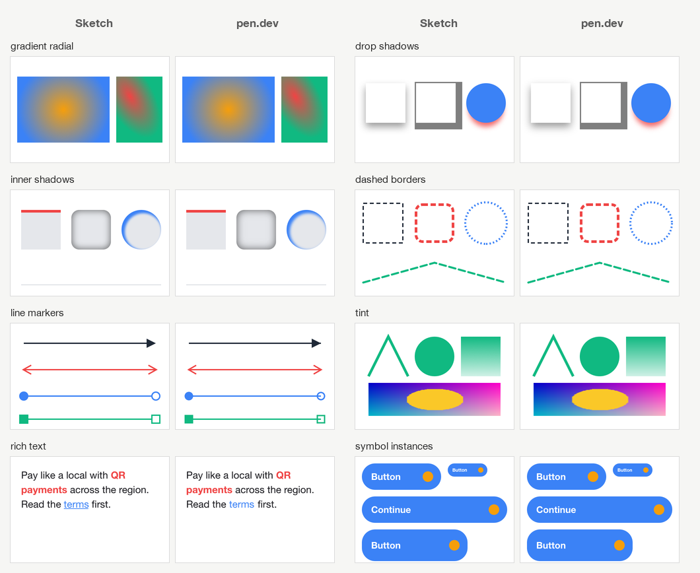

<p align="center"></p>

<h1 align="center">sketch2pen</h1>

<p align="center">Convert Sketch designs into <a href="https://pen.dev">pen.dev</a> documents – and pen.dev documents back into Sketch – directly, with no Figma in between.</p>

<p align="center">
  <a href="https://github.com/b4rtt/sketch2pen/actions/workflows/ci.yml"></a>
  <a href="https://github.com/b4rtt/sketch2pen/releases/latest"></a>
  <a href="LICENSE"></a>
</p>

- **Both directions.** Sketch → pen.dev and pen.dev → Sketch, from the command line or the *Sketch ⇄ Pen* app.
- **Native documents.** Layers stay editable: symbols ⇄ components with overrides, Sketch Stacks ⇄ flex layout,
  colour swatches ⇄ variables, fonts travel with the document.
- **Pixel-close.** Every feature is verified against the renderers of both apps: Sketch → pen.dev differs by a median
  of **0.09 %** of pixels across its feature lab and **0.6 %** across a real 386-artboard production design;
  pen.dev → Sketch by **0.05 %** across its feature lab and **0.4–1 %** across real pen.dev documents.
- **Current files.** Sketch 2025/2026 documents (frames, stacks, tints, pins, smooth corners) as well as older files
  saved by Sketch 43 or newer; pen.dev documents up to schema 2.20 and older ones.



## Status

Both directions and the app are complete (since version 2.0.0): Sketch → pen.dev, pen.dev → Sketch, the *Sketch ⇄ Pen*
app for macOS and the command line for macOS, Linux and Windows. What a format cannot express is listed in the
limitations below and in every conversion report.

## Install

### macOS app

1. Download **`Sketch-Pen-macos.zip`** from the [latest release](https://github.com/b4rtt/sketch2pen/releases/latest) and move
   *Sketch Pen* to your Applications folder.
2. Open the app, drop a `.sketch` or `.pen` file into its window (or click *Choose File…*), check the direction and the
   options and click **Convert**. The result opens in pen.dev or Sketch; the window lists what was converted
   approximately. Files dropped onto the app icon are converted right away.

The app is not notarized by Apple, so macOS blocks it the first time: open **System Settings → Privacy & Security** and
click **Open Anyway** – or remove the quarantine flag in Terminal:

```bash
xattr -dr com.apple.quarantine "/Applications/Sketch Pen.app"
```

### Command line

Download the archive for your platform from the [latest release](https://github.com/b4rtt/sketch2pen/releases/latest):

| Platform | Archive |
| --- | --- |
| macOS (Apple Silicon) | `sketch2pen-macos-arm64.zip` |
| macOS (Intel) | `sketch2pen-macos-x64.zip` |
| Linux | `sketch2pen-linux-x64.tar.gz`, `sketch2pen-linux-arm64.tar.gz` |
| Windows | `sketch2pen-windows-x64.zip` |

```bash
# macOS (Apple Silicon) – put both files in a folder on your PATH
curl -L -o sketch2pen.zip https://github.com/b4rtt/sketch2pen/releases/latest/download/sketch2pen-macos-arm64.zip
unzip sketch2pen.zip -d ~/.local/bin

# Linux
curl -L https://github.com/b4rtt/sketch2pen/releases/latest/download/sketch2pen-linux-x64.tar.gz | tar -xz -C ~/.local/bin
```

On Windows, unzip `sketch2pen-windows-x64.zip` and run `sketch2pen.exe` from a terminal.

On macOS keep `sketch2pen-coretext` next to `sketch2pen`: it lets the converter wrap text exactly like Sketch and draw
SF Symbols as vectors. On Linux and Windows the converter works without it, with approximate text wrapping and SF
Symbols kept as text. If you downloaded the archive with a browser, clear the quarantine flag first:
`xattr -d com.apple.quarantine sketch2pen sketch2pen-coretext`.

### From source

Requires [Bun](https://bun.sh) 1.2 or newer (and Xcode Command Line Tools on macOS for the CoreText helper).

```bash
git clone https://github.com/b4rtt/sketch2pen.git
cd sketch2pen
bun install
bun src/cli.ts path/to/design.sketch
```

## Usage

The direction follows the file extension.

### Sketch → pen.dev

```bash
sketch2pen "Design.sketch"
```

This writes `Design (Pen)/` next to the Sketch file and opens the result in pen.dev:

```
Design (Pen)/
├── Design.pen      ← open in pen.dev
├── assets/         ← images from the Sketch file
├── fonts/          ← fonts shipped with the document (if any)
├── report.html     ← what was converted approximately, font decisions
└── report.json     ← the same report for scripts
```

| Option | Description |
| --- | --- |
| `-o, --out <dir>` | output folder (default: `<name> (Pen)` next to the Sketch file) |
| `-p, --pages <names>` | convert only these pages, comma separated |
| `--list` | list pages and artboards, then exit |
| `--embed-fonts <mode>` | `all` (default): ship fonts from the Sketch file and this computer · `document`: only fonts embedded in the Sketch file · `none`: substitute them |
| `--font-map <map>` | font substitutions, e.g. `"Brand Sans=Figtree,SF Pro=Inter"` |
| `--smooth-corners` | draw smooth (squircle) corners exactly as paths instead of editable rectangles |
| `--no-flex` | keep Sketch Stacks as absolute positions instead of flex layout |
| `--no-open` | do not open the result in pen.dev |
| `--json` | print the conversion report as JSON |

pen.dev has no pages, so every Sketch page becomes a titled section of one canvas; that keeps components linked across
pages. pen.dev keeps open documents in memory – if you convert a file again while it is open, close and reopen it.

### pen.dev → Sketch

```bash
sketch2pen "Design.pen"
```

This writes `Design (Sketch).sketch` next to the `.pen` file and opens it in Sketch. Images and the fonts the document
uses are embedded in the Sketch file.

| Option | Description |
| --- | --- |
| `-o, --out <file>` | output file (default: `<name> (Sketch).sketch` next to the `.pen` file) |
| `--embed-fonts <mode>` | `document` (default): fonts shipped with the `.pen` file and Google Fonts · `all`: also fonts installed on this computer · `none`: embed no fonts |
| `--no-symbols` | expand component instances instead of creating Sketch symbols |
| `--no-stacks` | keep flex layout as fixed positions instead of Sketch stacks |
| `--offline` | do not download Google Fonts, icons and remote images (uses the cache) |
| `--no-open` | do not open the result in Sketch |
| `--json` | print the conversion report as JSON |

Documents that sketch2pen created from Sketch get their pages back.

## Fonts

pen.dev loads [Google Fonts](https://fonts.google.com) by name. For every other font the converter picks the most
faithful option:

1. **Shipped with the document** – fonts embedded in the Sketch file (and, with `--embed-fonts all`, fonts installed on
   this computer) are copied to `fonts/` and registered in the document, so pen.dev renders the exact typeface.
   Collections (`.ttc`) are split into single faces. Mind the font licences before you share the folder.
2. **Substituted** – with no font file available, a close Google font is used (metric-compatible where one exists:
   Arimo for Helvetica/Arial, Tinos for Times, Cousine for Courier, Carlito for Calibri, Inter for SF Pro …).
   Override the choice with `--font-map`.

Variable fonts are rendered by pen.dev at their default optical size, which makes some fonts (e.g. Inter 4 at large sizes)
a few percent wider than in Sketch. The converter measures every text block with CoreText and widens fixed-width text
boxes just enough to keep Sketch's line breaks; for fonts it ships (such as Apple's SF Pro) it adds the difference to the
letter spacing instead, so the text is exactly as wide as in Sketch.

**SF Pro**: install Apple's fonts from [developer.apple.com/fonts](https://developer.apple.com/fonts/) and the converter
uses the *SF Pro Text* or *SF Pro Display* cut that matches each text size, like Sketch does. Apple's licence allows them
only for mock-ups of apps for Apple platforms and forbids passing them on, so keep converted folders with SF Pro to
yourself.

## What gets converted

### Sketch → pen.dev

| Sketch | pen.dev |
| --- | --- |
| Pages, artboards / frames, groups | one canvas with a titled section per page, frames, groups |
| Rectangles, ovals, paths, boolean groups, point corner radii | rectangles, ellipses, SVG paths (booleans computed with Skia PathOps) |
| Colour, linear, radial and angular gradients, image fills, blend modes | fills (gradients re-mapped to pen.dev's coordinate system) |
| Borders – several widths, dashes, line-end arrows | strokes, plus exact outlines where pen.dev has no equivalent |
| Drop shadows (incl. spread), inner shadows, layer and background blur | effects, emulated where pen.dev falls short |
| Masks (outline, alpha, symbols as masks) | clipping frames with the mask's radii; other outlines cut vector shapes and images exactly, alpha masks are baked into images |
| Tints on groups, frames and instances | recoloured content |
| Text styles, mixed-style paragraphs, paragraph spacing, text transform | text layers (split per line/paragraph where pen.dev lacks inline formatting) |
| Underline, strikethrough | drawn as shapes exactly where Sketch draws them (pen.dev does not draw them) |
| SF Symbols and icon-font glyphs | vector paths |
| Symbols, overrides, symbol swaps, resized and scaled instances | components and instances with overrides; Sketch's pinning rules applied |
| Stacks | flex layout when it reproduces Sketch exactly, absolute positions otherwise |
| Colour swatches | pen.dev colour variables |

[docs/conversion.md](docs/conversion.md) documents every mapping and how each emulation works.

These limitations come from the pen.dev format and are listed in each conversion report:

- underline and strikethrough are drawn as separate shapes (pen.dev does not draw them) – on macOS only;
- texts and symbol instances reaching past a path- or ellipse-shaped mask are clipped by the mask's bounds;
- noise fills, motion/zoom blur, the glass blur and colour adjustments have no pen.dev equivalent;
- prototype links, layout grids, guides and export presets are not converted;
- text baselines can differ by up to 1 px for some size / line-height combinations.

### pen.dev → Sketch

| pen.dev | Sketch |
| --- | --- |
| Frames, groups, flex layout | artboards and frames, groups, stacks with the positions pen.dev computes |
| Rectangles, ellipses (arcs, rings), polygons, paths | rectangles, ovals, polygons, shape paths and combined shapes |
| Colour, gradient and image fills, strokes (also per side), shadows, blurs | fills, borders, shadows, blurs |
| Text (fonts, line height, letter spacing, alignment, wrapping) | text layers on the same baselines |
| Components and instances with overrides, nested components | symbols and instances with overrides and symbol swaps |
| Colour variables, themes | colour swatches, values resolved per theme |
| Icons (lucide, feather, Material Symbols, Phosphor) | vector shapes from the icon fonts pen.dev uses |
| Fonts shipped with the document, Google Fonts | fonts embedded in the Sketch document |

pen.dev's layout is re-computed (text measured with the same font files) so every layer lands where pen.dev draws it.
Instances Sketch could not draw exactly like pen.dev (e.g. a different background on the instance itself) are
expanded into plain layers; mesh gradients and shader fills have no Sketch equivalent. See
[docs/pen-to-sketch.md](docs/pen-to-sketch.md).

## How it works

**Sketch → pen.dev:** the converter reads the `.sketch` archive (JSON + images + fonts), converts the layer tree into
pen.dev's node schema and writes a `.pen` file that pen.dev opens directly. Geometry that pen.dev cannot express
natively is computed with [Skia PathOps](https://skia.org/docs/user/modules/pathkit/) (booleans, dashes, markers, mask
intersections); text is laid out with CoreText exactly like Sketch does.

**pen.dev → Sketch:** the `.pen` document is expanded (component instances, themes), laid out like pen.dev does it and
written as a Sketch document with the fonts and images it needs. See [docs/architecture.md](docs/architecture.md).

## Development

```bash
bun install
bun test            # unit and conversion tests
bun run typecheck
bun run build       # release artifacts in dist/
bun run lab         # Sketch → pen.dev feature lab: render every feature in both apps and diff them (macOS)
bun run lab:pen     # the same for pen.dev → Sketch
bash tools/build.sh --app   # build the macOS app for this Mac into dist/
```

[docs/development.md](docs/development.md) covers the feature lab, the comparison tool and releasing.
Contributions are welcome – see [CONTRIBUTING.md](CONTRIBUTING.md).

## License

[MIT](LICENSE). Third-party components are listed in [THIRD_PARTY_NOTICES.md](THIRD_PARTY_NOTICES.md).

sketch2pen is an independent project, not affiliated with Sketch B.V. or pen.dev.
